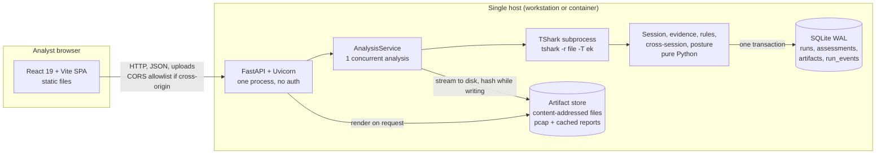
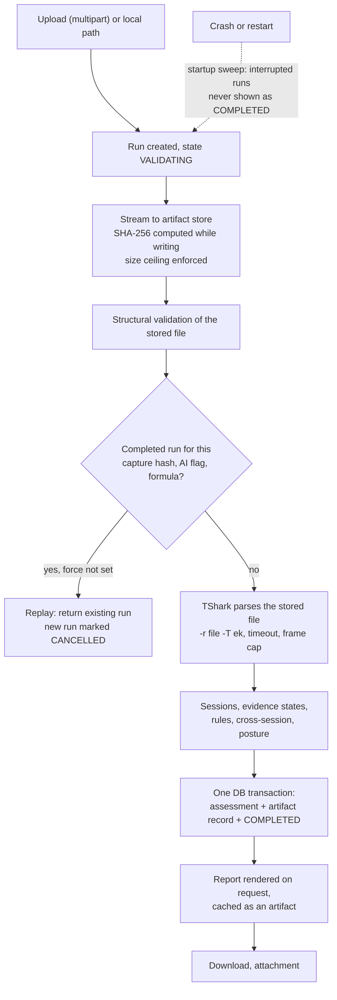
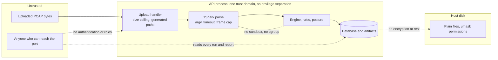
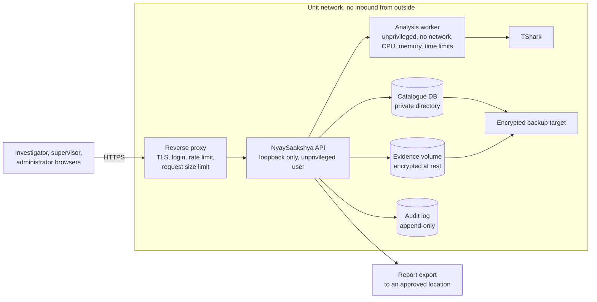
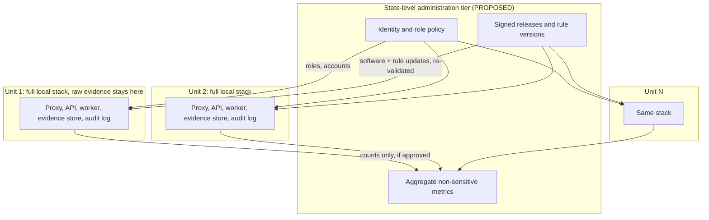

# NyaySaakshya Deployment Architecture

**Baseline inspected:** branch `design/landing-redesign`, commit `c0f77b9`, tag `v1.1.0-validation-baseline` (posture engine 0.10.0, rules 1.4, checklist 1.1, schema 1.1; 1,521 tests passed at Phase B.4). The forensic behaviour is documented in [`VALIDATION.md`](VALIDATION.md) and is **not** restated or changed here.

**How to read the labels.** Every capability in this document carries one of: **IMPLEMENTED** (found in the code and exercised by the test suite or by inspection), **PARTIALLY IMPLEMENTED**, **PROPOSED** (a design, nothing built), **REQUIRED BEFORE PILOT**, **REQUIRED BEFORE SCALE**, **NOT VERIFIED** (could not be established from the repository). Nothing marked PROPOSED exists. Where this document and old prose disagree, the code won; the inspected files are named so a reviewer can check.

---

## 1. Executive Summary

NyaySaakshya today is a **validated single-analyst prototype**: a React console and a FastAPI service that reads an uploaded SMTP/IMAP/POP3 capture with TShark, builds evidence-linked findings and a posture, stores them, and renders JSON/HTML/PDF reports. The forensic logic is validated on a controlled corpus (VALIDATION.md). The *deployment* is not: it has **no authentication, no authorization, no audit trail, no deletion or retention control, no TLS of its own, and a known SQLite concurrency defect** (TECH-DEBT #10). It is suitable for demonstration and for analysing test captures. It is **not** suitable for real investigative evidence.

The path to a pilot is short and mostly additive, because the architecture already has the right seams: a content-addressed artifact store whose SHA-256 is computed while the upload is written; one canonical assessment that every surface consumes; one SQLite catalogue with atomic finalisation; a stateless-looking analysis call with explicit resource limits; and **no outbound network calls anywhere in `src/`**. A controlled cyber-cell pilot needs roughly a dozen controls (section 17, P0), none of which changes the frozen semantic contract.

**Recommended topology.** Pilot: one hardened server or workstation inside the unit, reverse proxy with TLS, accounts and three roles, encrypted evidence volume, audit log, tested backup. Scale: **hybrid, local processing**: raw captures never leave the investigating unit; a central tier, if built, carries administration, rule and software updates, and aggregate non-sensitive metrics. Centralising raw PCAPs is not assumed to be necessary or desirable.

**Classification (Phase C): B — validated prototype with a credible pilot deployment path.** Not pilot-ready, not production-ready.

---

## 2. Product Scope and Non-Goals

**Scope (IMPLEMENTED):** passive, offline analysis of an uploaded capture of SMTP, IMAP and POP3 traffic, including implicit TLS; evidence states and provenance per fact; deterministic rules; cross-session comparison; a posture that is withheld when evidence is insufficient; reports (HTML in English/Marathi/both, PDF, JSON). Protocols other than the three are reported as unsupported and not graded.

**Non-goals, permanently or until separately engineered:**

- Not an autonomous fraud detector; the ML lane is off by default and cannot change a finding, the band or the score (VALIDATION §14.11).
- No attribution of an attacker, no determination that fraud occurred.
- No live capture, no connection to any mail server, no decryption, no message-content analysis.
- Not a legal chain-of-custody system. A SHA-256 and provenance chain give **traceability**, not legal custody (README, landing copy).
- Not a general network analyser; mail on an unrecognised port is withheld, not detected.

---

## 3. Current Prototype Architecture

How it runs today (verified in `Dockerfile`, `render.yaml`, `backend/__main__.py`, `demo/commands/start_demo.sh`): `python -m nyaysaakshya.backend --host --port --data-dir`; locally bound to `127.0.0.1` by default (a warning is logged for any other host); the Docker image (Ubuntu 24.04 plus the Wireshark PPA, `0.0.0.0`) is what the Render blueprint deploys, on a free plan with **no persistent disk**, so stored analyses are lost on restart.

---

## 4. Current Component Inventory

| Component | Purpose | Technology (verified) | Execution | Network exposure | Persistent state | External deps | Internet at runtime | Security boundary | Limitation |
|---|---|---|---|---|---|---|---|---|---|
| Analyst console | Upload, results, evidence, reports | React 19, Vite, TypeScript; fonts bundled via `@fontsource` | Static build in a browser; dev server for development | Served by whatever hosts the build (Vercel in the demo) | None server-side; browser state only | Backend API | **No** external URLs found in `frontend/src`, `index.html` | Browser same-origin policy; CORS allowlist on the API | **Demo-fixture fallback is compiled in** (`DISABLE_FIXTURE_FALLBACK = false`): if the API is unreachable the UI shows bundled demo analyses. Must be off for any real-evidence use |
| Legacy console | Older HTML console | `src/nyaysaakshya/dashboard/static`, mounted at `/dashboard` read-only | Same process as API | Same port | None | None | No | Fixed package path, not user input | Superseded by the SPA; same exposure as the API |
| API | Upload, run catalogue, assessment, dashboard projection, reports | FastAPI, Pydantic, Uvicorn (`backend/api.py`) | One process; GET and POST only | Port by `--port` (Docker 8000; Vite dev proxy targets 8001) | None | Service layer | No | **None**: no authentication or authorization (ADR-0011). CORS is opt-in (`SMS_ALLOWED_ORIGINS`), explicit origins, GET/POST | Anyone who can reach the port can upload, list and read every analysis |
| Analysis service | Admission, staging, pipeline, finalisation | `backend/service.py` | In-request, synchronous; `BoundedSemaphore(1)`; at most 8 admitted (`SMS_MAX_QUEUED_JOBS`) | In-process | Writes run state | TShark | No | Limits object (`backend/limits.py`) | Not a queue: a client waits for its analysis; no worker isolation |
| TShark | Dissection | OS package; argv array, never `shell=True`, `-r <file> -T ek`, streamed (`dissect/tshark.py`) | Subprocess of the API | None (file parsing only) | None | Wireshark dissectors | No | Process timeout `SMS_TSHARK_TIMEOUT_S` (300 s); `SMS_MAX_FRAMES` (2,000,000) | Runs as the API's user (the container has no `USER`, so root); no sandbox, cgroup or seccomp. Parses untrusted bytes |
| Analysis engine | Evidence, rules, posture | Pure Python, **zero runtime dependencies** in the core (`pyproject.toml`) | In the API process | None | None | None | No | Frozen semantic contract (VALIDATION) | CPU-bound, single process |
| ML lane | Optional anomaly signal | Stdlib robust-z model; scikit-learn only for research candidates, imported on demand | In process, off by default (`?ai=true`) | None | None | None | No | Cannot alter a conclusion (VALIDATION §14.11) | Research-grade; not a detector |
| Catalogue | Runs, assessments, artifact records, run events | SQLite, WAL, `synchronous=FULL`, FKs on (`backend/db.py`); file `securemailscope.db` | In process | File | Survives restart if the data dir is persistent | None | No | File permissions only (observed `0644` file, `0755` directory on a development data dir; default umask) | **One shared connection across threads (TECH-DEBT #10, OPEN, mitigated only by the UI serialising its requests): two overlapping reads were reproduced raising "database disk image is malformed"**. A second client or a script reopens this |
| Artifact store | Raw captures and rendered reports | Content-addressed paths from generated ids only (`backend/artifacts.py`) | In process | Local disk | Survives restart if persistent | None | No | Path traversal removed structurally; `absolute()` refuses paths outside the root | No encryption at rest, no per-case separation, **no delete API** (nothing removes evidence), permissions by umask |
| Report renderer | JSON, HTML, PDF (and Marathi) | stdlib HTML, ReportLab | In process | Via API | Cached as artifacts | ReportLab | No | Output escaped; `Content-Disposition: attachment` on downloads | Marathi is an unreviewed machine draft |
| Container / host | Packaging | `Dockerfile` (Ubuntu 24.04, PPA TShark), `render.yaml` | Docker | `0.0.0.0:$PORT` | `/data` (ephemeral on the free plan) | `apt`, PPA, `pip` at build | **Build time only** | Container boundary only | **TShark version:** golden cases were established on 4.6.8; the image comment records 4.6.6 reproducing them; the image was not built or run in Phase B (VALIDATION RP-12 NOT TESTED) |

---

## 5. Evidence Lifecycle

| Stage | What the code does (verified) | What it does not do |
|---|---|---|
| Storage | The original bytes are written once to `<root>/<2-char shard>/<run id>/<artifact id>.pcap`; the path uses generated identifiers only; the client filename is kept as a sanitised display label | No second copy, no write-once/immutable flag, no encryption, no per-case directory |
| Hash | SHA-256 is computed **during the write**, so the digest describes the bytes that landed on disk; it becomes `capture_id`. The service can re-hash on demand (`verify`) and raises `ArtifactIntegrityError` on mismatch | No signature, no timestamp authority, no trusted third party; a person with disk access could replace both file and database row |
| Retention | The original is **kept**; nothing deletes it; temporary staging is the stored file itself (no separate temp copy) | No retention policy, no archive, no deletion workflow (there is no `DELETE` route) |
| Metadata persisted | Run id, state, timestamps, duration, capture hash, original display name, formula, AI flag, versions, ingest status, assessment JSON (verbatim), artifact record, run events | No uploader identity, no case reference, no access log |
| Repeatability | Same bytes, same software, same configuration give the same assessment ID and content (VALIDATION §14.10); a different engine or rule-set version gives a different ID | Different TShark versions can change output (documented); the ID does not cover the TShark version |
| Reports | Rendered from the stored assessment on request, cached content-addressed; the same stored assessment renders to the same bytes | The analysis timestamp is embedded, so independent re-analyses differ in bytes |
| Errors and restarts | A failed run is recorded with a code and no traceback in the response; finalisation is atomic; interrupted runs are swept at startup | No automatic retry, no queue persistence (analysis is in-request) |
| Access by others | Anyone who reaches the API can read every run, assessment and report; the data directory is readable by local users per umask | No isolation between users or cases |
| Leaves the machine? | **No outbound call was found anywhere in `src/`** (searched for HTTP, socket and mail clients); the frontend has no external URL; fonts are bundled | See section 7 for what is *not* verified |

The hash supports **integrity identification** (is this the same file the analysis was made from?). It is not a legal chain of custody: custody needs identified persons, controlled access, an audit trail and procedure, none of which the prototype provides.

---

## 6. Current Security Boundary

Bounded audit by code reading and the existing tests. Not a penetration test.

Trust boundaries, current prototype (dashed = no control exists today; solid = a control exists):

Proposed pilot boundaries (section 9) add: a TLS and login boundary at the proxy, an unprivileged no-network worker boundary around TShark, an encrypted evidence volume, and an append-only audit log.

| Control | Status | What exists | Blocks a real-evidence pilot? | Minimum proportionate mitigation | Defer to scale |
|---|---|---|---|---|---|
| Authentication | **NOT IMPLEMENTED** | None; the code states it (ADR-0011) | **Yes** | Local accounts behind the reverse proxy (or proxy-level auth) | SSO / directory integration |
| Authorization / roles | NOT IMPLEMENTED | None | **Yes** | Three roles (section 11) | Fine-grained policy |
| Case-level isolation | NOT IMPLEMENTED | `run_id` only; no case concept | **Yes** | Case reference on each run; access scoped by case membership | Per-unit tenancy |
| Session / CSRF | NOT APPLICABLE today | No sessions; GET/POST with CORS allowlist, no cookies | Becomes required once accounts exist | Same-site cookies or token auth, CSRF token on POST | |
| CORS | IMPLEMENTED | Opt-in, explicit origins, GET/POST, never a wildcard by design | No | Keep; pilot is same-origin behind the proxy | |
| Upload validation | PARTIAL | Size ceiling during streaming (256 MiB default, clamped by the 2 GiB capture ceiling), structural pcap/pcapng check, sanitised display name, generated paths | No | Keep | Content-type allowlist at the proxy |
| Filename and path handling | IMPLEMENTED | Traversal removed structurally; stored paths re-checked on read; tests cover hostile names (VALIDATION RE-6, ER-10) | No | | |
| Parser execution | PARTIAL | Argument array, timeout, frame cap, streamed output | Yes for real evidence | Run TShark as an unprivileged user in a restricted container (no network, read-only root, memory/CPU limits); non-root user in the image | Per-job disposable worker |
| Analysis time limit | **PARTIAL** | `SMS_MAX_ANALYSIS_SECONDS` exists and an error class exists, but the service does not enforce it; only the TShark timeout is enforced | Yes (small) | Enforce a wall-clock limit around the pipeline | |
| Concurrency | **PARTIAL, known defect** | One analysis at a time; SQLite connection shared across threads; reproduced crash on overlapping reads (TECH-DEBT #10) | **Yes** for more than one user | One connection per thread, or a lock on every cursor (a backend change, deliberately outside the frozen semantics) | Move to a server database |
| Temp-file cleanup | IMPLEMENTED (partial) | Failed or oversized uploads are discarded; stored evidence is deliberately kept | No | | |
| API exposure | PARTIAL | Read and write of everything to anyone reaching the port; binds to loopback by default | **Yes** if reachable by others | Bind to loopback; expose only via the authenticating proxy | |
| Report access | NOT IMPLEMENTED | Anyone may fetch any report | Yes | Same authorization as the run | |
| Database permissions | NOT VERIFIED beyond file mode | Observed `0644` file, `0755` directory | Yes | Service account owns the data directory, mode `0700` | Server DB roles |
| Encryption in transit | NOT IMPLEMENTED in-app | Plain HTTP from Uvicorn; TLS is left to the host | **Yes** | TLS at the reverse proxy; backend on loopback | mTLS between tiers |
| Encryption at rest | NOT IMPLEMENTED | None | **Yes** | Full-volume encryption on the evidence volume | Key management service |
| Secrets handling | PARTIAL | No secrets in the repository were found by inspection; configuration is via `SMS_*` variables; nothing is read from a secret store | No | Keep secrets out of images; environment or file with `0600` | Secret manager |
| Audit logging | **NOT IMPLEMENTED** | `run_events` records job state transitions only (no person, no read access); Python logging to stderr | **Yes** | Append-only audit events for upload, view, report, export, role change (section 12) | Tamper-evident shipping |
| Retention and deletion | **NOT IMPLEMENTED** | Nothing deletes; no policy | **Yes** | Supervisor-approved archive and deletion with an audit event | Automated schedules |
| Backup and recovery | NOT IMPLEMENTED | SQLite WAL on one disk; the free-plan blueprint loses everything on restart | **Yes** | Nightly encrypted copy of database plus artifacts, restore rehearsal | Replication |
| Rate limiting | NOT IMPLEMENTED | Admission cap (8 in flight) only | No for a closed pilot | Proxy rate limit | |
| Runtime isolation | NOT IMPLEMENTED | Container only; image runs as root | Yes (small) | Non-root user, read-only root filesystem | |
| Supply chain | NOT VERIFIED | Pinned lower bounds in `pyproject.toml`, `package-lock`; no SBOM or scan performed | No | Pin, scan and record versions for the pilot | |
| Hygiene | NOT VERIFIED | TECH-DEBT #16 (a committed browser profile) is recorded as open but `frontend/.chrome-profile` is no longer tracked, so the entry looks stale | No | Close the entry | |

---

## 7. Offline and Internet Dependencies

| Phase | Needs internet? | Evidence |
|---|---|---|
| Installation | **Yes** (conditional): `pip`/`npm` packages; on Linux, `apt` plus the Wireshark PPA for the pinned TShark | `Dockerfile`, `pyproject.toml`, `frontend/package.json` |
| Development | Optional | Vite dev server, test tooling |
| Capture analysis (runtime) | **No call found** | No HTTP/socket/mail client in `src/`; TShark is invoked on a file with no live-capture flags |
| Frontend runtime | **No external URL found** | None in `frontend/src` or `index.html`; IBM Plex and Marathi fonts are bundled (`@fontsource`); TECH-DEBT #1 (offline fonts) is recorded as resolved |
| Report generation | No | stdlib and ReportLab, no remote assets |
| ML | No | Stdlib model; no model download, no telemetry |
| Remote telemetry or update checks | None found | |

**Strongest defensible claim (static inspection):** *the core capture-analysis pipeline is designed to run locally without sending uploaded captures to a third-party analysis service.*

**NOT VERIFIED:** operation in an air-gapped network. No isolated-network test was performed, the Docker image was not built or run in validation, and installation of TShark, Python and Node dependencies needs a mirror or an offline bundle. "Local-first" is supported by the code; "air-gapped verified" is not claimed.

---

## 8. Deployment Principles

1. **Evidence stays where the investigator is.** Raw captures are not sent to any service the unit does not control.
2. **Do not weaken what is validated.** Deployment layers wrap the frozen engine; they never alter evidence states, rules, scoring, coverage or identity. A software or rule change is a versioned, re-validated release (VALIDATION §15.7).
3. **Pin the toolchain.** The TShark version changes output; a deployment records and checks it.
4. **Say what is not established.** Withheld postures, limitations and unsupported scope are shown, never hidden to look complete.
5. **Prove each control.** Every proposed control below names an acceptance test.
6. **Smallest credible step first.** A single-unit pilot before any state-level design.

---

## 9. Controlled Cyber-Cell Pilot  (PROPOSED)

Components used, each only because a requirement needs it:

| Component | Why | Acceptance test |
|---|---|---|
| Reverse proxy with TLS | In-app TLS is absent; also gives login and limits | Plain HTTP refused; TLS scan shows no legacy protocol; backend not reachable except from the proxy |
| Local accounts, three roles | No identity exists | Unauthenticated request to every route returns 401; role matrix test (section 11) |
| Case reference, access by case | Cross-case reading is possible today | A user outside the case cannot list, read or download any run of it |
| Encrypted evidence volume | Raw captures are sensitive | Volume unmounted: files unreadable; recovery key procedure rehearsed |
| Private data directory, service account | umask `0644` today | Another local user cannot read the database or artifacts |
| Audit log | None exists | Every upload, view, report, export, role and retention action produces one event naming the person; events cannot be edited through the application |
| Retention and archive workflow | Nothing can be removed or governed | Archive and deletion need supervisor approval and leave an audit event; file and database row are both gone or both kept |
| Backup and restore | Single disk, SQLite | A restored copy re-verifies every artifact hash and the assessment rows load |
| Worker isolation and limits | Parser handles hostile bytes | A crafted slow or huge capture is stopped by the wall-clock and memory limits and leaves the service up |
| SQLite concurrency fix | Known crash | Parallel reads and writes (scripted) produce no error |
| Demo fixtures disabled | Bundled demo analyses appear if the API is down | With the API stopped the UI shows an error, not a demo analysis |
| TShark version check | Version changes output | Start-up refuses or warns on a version different from the validated one; golden captures reproduce |
| Monitoring | Silent failure | Health endpoint alerts; disk-space and failed-run alerts |
| Update procedure | Software/rule changes | Release records engine, rules, schema and TShark versions; golden cases re-run before and after |

Scope boundary: one unit, one server, a handful of named users, captures supplied by the unit, no connection to external systems. This is a **technical pilot**; handling live case evidence additionally needs the decisions in section 22.

---

## 10. Multi-Unit / Maharashtra-Scale Architecture  (PROPOSED, no integration exists)

Three models compared:

| | A. Separate installations | B. Centralised state deployment | C. Hybrid: local processing, central administration |
|---|---|---|---|
| Evidence sensitivity | Best: raw captures never leave the unit | Worst: all raw evidence concentrated in one place | Same as A for raw evidence |
| Bandwidth and capture size | None | Large uploads over unit links; reliability of links matters | None for evidence; small metadata only |
| Network reliability | Independent | Every unit depends on the link and the centre | Units work offline; central tier is best-effort |
| Maintenance ownership | Every unit patches itself; drift likely | One team | Central team ships signed releases; units apply them |
| Policy and rule updates | Manual per unit | Instant | Versioned releases, re-validated against the golden cases |
| Central access governance | None | Strong | Directory and role policy managed centrally; enforced locally |
| Aggregate metrics | None | Easy but includes sensitive data | Only non-sensitive counts leave units (design choice) |
| Disaster recovery | Per unit | Centralised, one large target | Per unit locally; central holds configuration |
| Availability | Per unit | Single point of failure unless replicated | Unit work unaffected by central outage |
| Worker scaling | Per unit | Central worker pool | Per unit |

**Recommendation: C, reached through A.** Roll out as A (separate hardened installations), then add a central administration layer for identity, release distribution and aggregate metrics. Do not centralise raw PCAPs unless a legal and policy decision requires it.

What would make this feasible rather than speculative: each unit runs the same pinned container image; the only central coupling is administration; the engine is deterministic and versioned, so a release can be verified by re-running the golden captures at the unit. What does not exist: any Maharashtra system integration, any procurement, any authority commitment.

---

## 11. Authentication and RBAC  (PROPOSED, REQUIRED BEFORE PILOT)

Simplest suitable path: **local accounts at the reverse proxy or in a small auth layer for the pilot**; a directory (LDAP/Active Directory or another government identity provider) is a *scale* option and is not demonstrated.

| Permission | Investigator | Supervisor | Administrator |
|---|---|---|---|
| Upload a capture to a case they belong to | Yes | Yes | No |
| View runs, assessments, evidence of their cases | Yes | Yes (cases they supervise) | No evidence content |
| Generate and download reports | Yes | Yes | No |
| Archive / delete evidence | Request | **Approve and execute** | No |
| Manage users and roles | No | No | **Yes** |
| Review audit log | Own actions | Cases they supervise | Full, read-only |
| Configure retention | No | Propose | **Yes**, with supervisor co-approval |
| Change software or rule version | No | No | Yes, with release record |

The administrator is deliberately not an evidence reader: separation of duties limits what a compromised admin account exposes. Acceptance test: a role matrix test that exercises every route as every role and asserts the table.

---

## 12. Evidence Storage and Auditability  (PROPOSED unless stated)

| Layer | Contents | Status |
|---|---|---|
| **Raw evidence** | Original capture, SHA-256, ingestion time, original filename, **case reference** | File, hash and filename IMPLEMENTED; case reference PROPOSED |
| **Derived analysis** | Assessment, evidence observations, findings, posture and score state, engine/rule/schema versions, reports | IMPLEMENTED (stored verbatim, versions included) |
| **Audit metadata** | Uploader, access, report generation, archive and deletion, configuration changes | **NOT IMPLEMENTED** (only job-state `run_events`) |

Pilot design points: verify the hash of the stored file against the recorded digest before each analysis (the verify routine exists; calling it before analysis is PROPOSED); keep the link raw → derived by `capture_id`; make the audit log append-only and written by the application, separate from the catalogue; define retention per case type with supervisor approval; restore from backup and re-verify every artifact hash. **This is traceability and integrity evidence, not a legal chain-of-custody solution.** Whether it can support admissibility is a legal question outside this document.

---

## 13. Threat Model

Defensive, architecture-level.

| Threat | Today | Pilot mitigation | Scale mitigation |
|---|---|---|---|
| Malicious PCAP / parser exhaustion | Size ceiling, frame cap, TShark timeout, argv invocation; no sandbox; pipeline wall-clock not enforced | Unprivileged worker, no network, memory/CPU/time limits, enforce the pipeline timeout | Disposable per-job workers, queue with limits |
| Unauthorized evidence access | None; all data reachable by anyone on the port | Authentication, roles, loopback binding, private data directory | Directory-backed policy, per-unit tenancy |
| Cross-case access | No case concept | Case membership checks on every route | Per-unit isolation |
| Accidental deletion | No delete exists (also no retention) | Approval workflow, audit, backups | Immutable archive tier |
| Report tampering | Reports are regenerated from the stored assessment; each carries hashes; no signature | Store report hash in the audit event; verify on download | Signed reports with an organisational key |
| Stolen credentials | No credentials exist | Strong passwords or second factor at the proxy, lockout, session expiry | SSO with the directory's policy |
| Exposed API | Binds loopback by default; Docker image binds all interfaces | Never exposed directly; proxy only | Network segmentation, WAF if justified |
| Disk compromise | Plaintext at rest, umask permissions | Volume encryption, `0700` directory | Key management, hardware-backed keys |
| Backup leakage | No backups | Encrypted backups, restricted target, restore drill | Offsite encrypted replication under policy |
| Version / assessment confusion | Assessment ID covers capture, analyser versions, ML flag, outcome (VALIDATION §14.9); not the TShark version | Record TShark version in the release; warn on mismatch | Central release registry |
| Demo data mistaken for real | UI falls back to bundled fixtures if the API is down | Disable fixtures in the pilot build, visible environment banner | |

---

## 14. Scalability and Resource Considerations

**No benchmark has been run.** README and VALIDATION state that scale is untested. The following are hypotheses from the code, not measurements.

| Area | Evidence from the code | Status |
|---|---|---|
| Upload | Streamed to disk in 1 MiB chunks, hashed on the way; ceiling 256 MiB default | Design, not measured |
| TShark | Streamed `-T ek` output, so memory is bounded by design; one process per analysis; timeout 300 s; frame cap 2,000,000 | Hypothesis |
| CPU | Session reconstruction and rules are pure Python in the API process | Likely the dominant cost; **not measured** |
| Memory | Sessions are held in memory per analysis | Hypothesis |
| Disk I/O | One write of the capture, one read by TShark, small database writes | Hypothesis |
| Database | One SQLite writer, WAL; one shared connection (defect) | Known limit |
| Reports | Rendered on request, then cached | Not measured |
| Concurrency | One analysis at a time, up to 8 admitted | Design |

Progression: single local analysis (today) → controlled single-worker pilot → queued jobs with explicit resource limits → isolated, replicated workers → multi-unit. The analysis call is a function of a file and a configuration and writes one assessment, so it **appears** suitable for separating into workers; but today it runs inside the request, uses one shared SQLite file, and has never been run as multiple processes, so it must not be called stateless or horizontally scalable until that is built and tested. A **GPU is not required**: no dependency uses one (pure Python, TShark, stdlib ML).

---

## 15. Infrastructure Profiles

*Preliminary recommendation, not benchmark-derived.* To be replaced by measured values in Phase D or in the pilot.

| Profile | Shape | Starting point | Notes |
|---|---|---|---|
| 1. Development / demo | One laptop or workstation, loopback | Ordinary developer machine; the project runs on a macOS laptop today | SQLite, ephemeral or local data; analyse test captures only |
| 2. Controlled pilot | One hardened on-premise server or forensic workstation in the unit | Multi-core CPU, memory sized above the largest expected capture's working set, an encrypted SSD volume sized for retained evidence plus a separate backup target | No GPU; capacity to be set from a measured pilot run |
| 3. Multi-unit | The profile-2 stack per unit, plus a small administration tier | Per-unit as above; central tier carries identity, releases, aggregate metrics only | Raw evidence not centralised |

---

## 16. Deployment Options Comparison

| | Workstation | On-premise server | Private / state data centre | Public cloud |
|---|---|---|---|---|
| Evidence control | Highest, physical | High | High if governed | Lowest; depends on region, contract and policy not in scope here |
| Maintenance burden | Per machine | One host per unit | Central team | Provider manages hardware, unit manages software |
| Scalability | None | Vertical | Horizontal, if built | Easiest, if built |
| Offline operation | Yes | Yes | Within the network | No |
| Complexity | Lowest | Low | High | Medium to high |
| Cost characteristics | Lowest capital | Moderate capital | High capital and staff | Operating expense, egress and storage; **not costed here (Phase D)** |
| Fit | Demo, single analyst | **Controlled pilot** | Later, multi-unit | Demo hosting only; the current Render free plan is explicitly ephemeral |

---

## 17. Implementation Gap Map

P0 = required before real evidence enters a pilot; P1 = required before broader deployment; P2 = later improvement.

| Capability | Current state | Pilot requirement | Scale requirement | Priority |
|---|---|---|---|---|
| Authentication | None | Local accounts behind TLS proxy | Directory / SSO | **P0** (anyone with network reach reads all evidence) |
| RBAC | None | Three roles (section 11) | Policy engine | **P0** |
| Case isolation | None | Case reference, scoped access | Per-unit tenancy | **P0** |
| HTTPS | None in app | TLS at the proxy | mTLS between tiers | **P0** |
| Raw-evidence storage | Plain files, no encryption, umask perms | Encrypted volume, `0700`, service account | Key management, immutable tier | **P0** |
| Persistent database | SQLite file; blueprint data is ephemeral | Persistent local volume | Server database | **P0** (persistence); server DB is P1 |
| SQLite concurrency | Known shared-connection defect | Fixed and tested | n/a | **P0** (more than one user) |
| Audit logging | Job events only | Append-only audit of access and actions | Tamper-evident shipping | **P0** |
| Retention / deletion | None, no delete route | Approval workflow with audit | Scheduled policy | **P0** |
| Backups and recovery | None | Encrypted backup, restore drill, hash re-verification | Replication, RPO/RTO targets | **P0** |
| Worker isolation | Same process and user; image runs as root | Unprivileged worker, no network | Disposable workers | **P0** |
| Resource limits | Size, frames, TShark timeout; pipeline timeout not enforced | Enforce wall-clock, memory limits | Per-job cgroups | **P0** (small) |
| Demo fixtures off | Compiled in | Disabled in the pilot build, environment banner | | **P0** |
| TShark version control | Documented, image unbuilt | Version check at start, golden captures reproduce | Release registry | **P0** (small) |
| Monitoring | Health endpoint, logs | Alerts on health, disk, failed runs | Central dashboards | P1 |
| Job queue | In-request, 1 slot | Acceptable for a few users | Queue and workers | P1 |
| Centralised policy and rule updates | Manual | Documented release procedure | Signed distribution | P1 |
| Marathi review | Unreviewed machine draft | Native review before Marathi is relied on | Maintained glossary | P1 |
| Operational logging | stderr | Structured logs to a file | Aggregation | P1 |
| Supply-chain scanning | Not done | Pin and record versions | SBOM, scans in CI | P1 |
| Rate limiting | Admission cap | Proxy limit | WAF | P2 |
| Report signing | Hash only | | Organisational key | P2 |

Why these are P0: each lets a person without authority read, alter, lose or contaminate evidence, or lets one capture take the service down. A hackathon demonstration on test captures needs none of them; a pilot on real evidence needs all of them.

---

## 18. Adoption Roadmap  (PROPOSED; no dates, no commitment from any authority)

| Stage | Objective | Additions | Security controls | Topology | Acceptance tests | Exit criteria | Effort |
|---|---|---|---|---|---|---|---|
| 0. Validated prototype | Show the forensic logic and evidence discipline | None (current) | Loopback, test captures only | Workstation | VALIDATION baseline, tag `v1.1.0-validation-baseline` | Done | Done |
| 1. Controlled technical pilot | Prove the deployment controls on **synthetic or consented captures** | The section 17 P0 items | Auth, roles, TLS, encrypted volume, audit, backup, isolation | One server, one unit's technical staff | Every acceptance test in section 9; golden captures reproduce in the pilot image; restore drill | All P0 tests pass and are recorded | Medium |
| 2. Single-unit operational pilot | Use on real cases under a policy | Case workflow, retention policy, Marathi review, operating procedure | Plus policy decisions in section 22 | Same, with monitoring | Unit users complete real-case tasks; audit review by a supervisor; incident drill | Written sign-off by the unit's own authority (not assumed) | Medium to large |
| 3. Multi-unit rollout | Same stack in several units | Signed release process, central administration, directory integration | Central roles enforced locally | Model C | Release applied at a second unit reproduces golden results; central outage does not stop unit work | Several units operating on one release line | Large |
| 4. State-scale operationalisation | Sustained operation | Queue and worker pool where needed, server database, DR, SLAs | Tamper-evident audit, key management | Model C with scaling | Load and failover tests on **measured** capacities | Operating organisation accepts responsibility | Large |

---

## 19. Validation and Acceptance Criteria

A deployment is accepted at a stage only when: (1) the **frozen validation baseline still holds**: the golden captures in the deployed image give the validated bands and scores (flagship CRITICAL 22.15, `backup_weak_certificate` 44.0, `scene_b` 100.0 STRONG), using the pinned TShark; (2) each control for the stage passes its named acceptance test (sections 9 and 11); (3) a restore from backup re-verifies every stored artifact hash; (4) the audit log shows the actions of a scripted session; (5) a hostile capture does not take the service down. Semantics are not re-validated for a deployment change; a change to rules, scoring, coverage, evidence or identity is a new validation baseline, not a deployment task.

---

## 20. Known Limitations

- No authentication, authorization, audit trail, deletion or retention control, TLS or encryption at rest in the application (section 6).
- SQLite shared-connection defect (TECH-DEBT #10); the UI serialises its requests as a mitigation only.
- `SMS_MAX_ANALYSIS_SECONDS` is defined but not enforced; TShark's own timeout is.
- Analysis runs in the request; there is no queue or worker separation; replication was never tested.
- The Docker image was not built or run in validation; the TShark version used by the image (4.6.x from the PPA) may differ from the validated 4.6.8; golden-case reproduction on it is NOT VERIFIED.
- Air-gapped operation is NOT VERIFIED.
- Performance, capacity and cost are unmeasured.
- Scope is SMTP, IMAP, POP3; mail on an unrecognised port is withheld; the validated corpus is synthetic or lab-generated plus ten real-vendor captures.
- Marathi reports and landing text are unreviewed machine drafts.
- The assessment ID does not cover the TShark version.
- Other known validation limits are in `VALIDATION.md` §14.14 and §15.

---

## 21. Competition-Safe Claims

Supported by the repository:

- Runs locally; the core analysis pipeline makes no outbound call and is designed to analyse captures without sending them to a third-party service (static inspection).
- Every uploaded capture is identified by a SHA-256 computed while it is stored; the digest travels into every report and can be re-verified.
- A stored analysis re-renders to the same report bytes; the same capture analysed by the same software gives the same assessment ID and content.
- Findings are evidence-linked and bounded; a capture that cannot support a grade is withheld, not scored.
- The forensic semantics are validated and frozen at a tagged baseline.
- A GPU is not needed.
- A controlled pilot path exists, with specific, testable controls, and the architecture keeps raw evidence local.

**Claims we must not make:** production ready; pilot ready; government approved or deployed; adopted by any Maharashtra unit or agency; integrates with any state system; court admissible or legal chain of custody; immutable or tamper-proof storage; air-gapped verified; secure in any deployment sense; scales horizontally or handles any stated throughput; accurate on real-world traffic; an AI fraud detector.

---

## 22. Decisions Required Before Real-Evidence Use

1. Who is the **owner and operator** of an installation, and who is accountable for its security?
2. The **legal and policy status** of the evidence handled (what the unit's procedure requires of storage, access and logging). This document does not determine admissibility.
3. **Identity source** for the pilot (local accounts or an existing directory) and who administers it.
4. **Retention periods and deletion authority** per case type.
5. **Where backups live** and who may hold the keys.
6. **Hosting**: workstation, unit server or a state facility; physical and network placement.
7. **Release authority**: who approves a software or rule change, and the re-validation required.
8. **Marathi**: whether a native review is required before Marathi output is relied on.
9. **Scope confirmation**: that SMTP/IMAP/POP3 is the right evidence type for the pilot's cases.
10. **Incident handling**: who responds if the service fails or evidence access is suspected.

---

## Judge-Ready Deployment Story

| # | Question | Technically accurate | 20-second answer |
|---|---|---|---|
| 1 | Where would it run? | Today on one workstation; a pilot would run on a hardened server or forensic workstation inside the investigating unit behind a TLS proxy. Hosted demo on a free plan is ephemeral | "Inside the unit, on its own machine. The online demo is only a demo." |
| 2 | Does the capture leave the unit? | In the **proposed on-premise** deployment, no: the code makes no outbound call and the multi-unit design keeps raw captures local. In the **current hosted demo** (frontend and backend on third-party platforms) an upload does leave the user's machine, so it is for test captures only | "In the on-premise design, no. The online demo is hosted, so it only gets test captures." |
| 3 | Does analysis need internet? | Not at runtime, by static inspection; installation needs packages; air-gapped operation is not tested | "Not to analyse. Installing needs packages. We haven't claimed an air-gap test." |
| 4 | GPU? | No dependency uses one | "No GPU. It is TShark and plain Python." |
| 5 | What happens to uploaded evidence? | Stored once, content-addressed, hashed while written, kept, never deleted by the prototype; no retention or deletion control yet | "Kept unchanged with its hash. Retention and deletion controls are a required pilot step, not built." |
| 6 | How is integrity supported? | SHA-256 at write, re-verifiable on demand, carried into every report; no signing or custody | "Every capture has a hash you can re-check. That is traceability, not legal custody." |
| 7 | Multiple investigators? | Not today: no accounts, and a known concurrency defect. A pilot adds accounts, roles, case isolation, audit and the concurrency fix | "Not yet. Accounts, roles and audit are the first pilot items." |
| 8 | Across Maharashtra? | Proposed: the same pinned stack in each unit, with a thin central administration tier for identity, releases and counts; nothing exists today | "Unit by unit, same validated package, central administration only. It is a pathway, not a deployment." |
| 9 | What before real evidence? | The P0 list in section 17: authentication, roles, TLS, encryption, audit, retention, backup, isolation, concurrency fix, fixtures off, plus the policy decisions in section 22 | "Security controls and a policy decision. The engine is validated; the wrapper is not yet." |
| 10 | Why feasible? | The needed seams already exist (hashing at write, one canonical assessment, atomic finalisation, resource limits, no outbound calls, a deterministic engine that can be re-verified at each site) and each missing control has a stated acceptance test | "The hard forensic part is validated; what's left is standard, testable engineering." |

The advantage to emphasise is not detection: it is moving from a capture to evidence-linked, bounded, reproducible findings, and saying plainly what the capture does not support.
