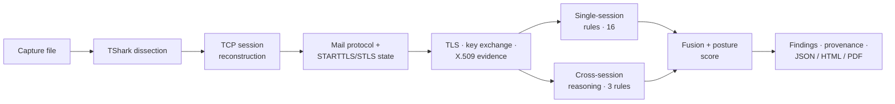
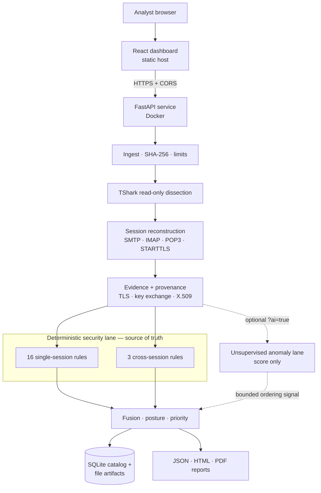

<p align="center">
  
</p>

# NyaySaakshya

**Forensic triage for cyber-fraud evidence: upload a network capture, see what matters, and put a timestamped, hash-verified report in the case file.**

> **Live demo:** _URL to be added after redeployment._ Until then, run it locally — see [Quick start](#quick-start). Ready-made sample captures are in [`demo/captures/`](demo/captures/).

---

## The problem

District and city cyber cells in Maharashtra receive more cyber-fraud complaints than they have forensic analysts to examine. Evidence queues up waiting for a specialist, and while it waits the forensic window — the period in which evidence is still fresh and recoverable — keeps closing. The first step is triage: working out, quickly, what a piece of evidence does and does not establish. Today that step needs scarce expertise.

## The solution

NyaySaakshya is a triage tool that a non-specialist can operate. An officer uploads the evidence; automated analysis surfaces what matters, ranked, with the proof behind each point; and the result is exported as a report that is timestamped and hash-verified so it can go into the case file.

- **Upload and read.** No protocol expertise is needed to operate it: you upload a capture file in the browser and read the result.
- **Automated analysis that shows its work.** Every finding is linked to the packets, the rule and the published standard behind it, so a specialist can later verify it instead of trusting it.
- **Honest about limits.** What a capture cannot establish is reported as such — never guessed and never silently upgraded to "safe". A capture in which nothing, or too little of the traffic, could be assessed yields "insufficient evidence", not a good grade.
- **Timestamped and hash-verified.** Each capture is identified by its SHA-256; each assessment and each rendered report carries its own hash; the analysis time is recorded. The same capture and software versions always produce the same evidence, findings and assessment ID, and a stored assessment always renders to the same report bytes.
- **Reports in JSON, HTML and PDF.** HTML and PDF open offline from disk.
- **Marathi reports (draft).** The HTML report can be produced in Marathi, or as Marathi followed by the unmodified English original (`?lang=mr` / `?lang=both`), with a "how to read this report" block for non-specialist readers. **The Marathi text is a machine draft that no person has reviewed yet**; every Marathi report says so at the top, and the English report is the authoritative one. PDF and JSON stay English. See [Reports](#reports).

### What it examines today

NyaySaakshya reads captured **SMTP, IMAP and POP3** traffic — including implicit-TLS SMTPS/IMAPS/POP3S — and reports the transport security of the email infrastructure that produced it: TLS version, cipher suite, key exchange, forward secrecy, STARTTLS/STLS upgrade integrity (is encryption being silently skipped or stripped?), plaintext exposure, insecure configuration, X.509 properties where a cleartext handshake exposes them, and what the capture genuinely could not establish.

That is the scope of the engine. It does **not** read message content, attribute an attack to a person, or decide that fraud occurred; it tells an examiner what the captured traffic does and does not show.

It is **passive and offline by design**: it never connects to a mail server, needs no keys or mailbox access, and performs no decryption.

## How it works



1. **Ingest & dissect** — the upload is hashed (SHA-256) and parsed read-only with `tshark -r <file> -T ek` (argument array, no shell).
2. **Reconstruct** — TCP streams become protocol sessions with an explicit STARTTLS/STLS state machine.
3. **Extract evidence** — every fact is wrapped with an evidence state, frame reference and provenance (see [Evidence & provenance](#evidence--provenance)).
4. **Judge deterministically** — 19 versioned, standards-bound rules (16 single-session + 3 cross-session), each cited to an RFC or NIST publication.
5. **Fuse & score** — findings become one `PostureAssessment` (score 0–100, band, coverage, prioritised remediation). Everything downstream consumes it and recomputes nothing.
6. **Report** — the same assessment is projected to a dashboard and to JSON, HTML and PDF reports.

## Why cross-session reasoning?

| | Question it answers |
|---|---|
| **Single-session analysis** | *What happened in this connection?* |
| **Cross-session reasoning** | *How does this connection behave relative to related sessions, or to a control population?* |

A client that never upgrades to TLS looks unremarkable on its own — 5 sessions out of 5 with no STARTTLS is simply consistent. The same behaviour becomes informative when **other clients at the same server** do upgrade. Comparisons are only made between genuinely comparable sessions (same client, server, port, protocol, TLS mode), against prior history only, and the engine **abstains** below a minimum history.

**The demonstrated scenario** ([`deepdive_cross_session_control_endpoint.pcap`](demo/captures/), 12 SMTP sessions to one server):

| | Subject `10.0.0.6` | Control `10.0.0.7` |
|---|---|---|
| STARTTLS | not observed (6 sessions) | observed (6 sessions) |
| TLS | none — clear | established (TLS 1.3) |
| Authentication | plaintext (6 sessions) | none recorded |

The engine reports `CS-STARTTLS-001` as a **deviation worth investigating**. It deliberately does **not** claim an attack or an attacker: a client-specific server policy produces identical bytes, and a capture alone cannot tell the two apart. With **no** control endpoint (`deepdive_cross_session_no_control.pcap`), the same behaviour is reported `COMPLIANT` together with an explicit statement of what passive evidence cannot rule out.

## What an analyst sees

Seven views: **Overview** (score, why-this-score, proof, observability boundary) · **Findings** · **Protocol** (per-stream journey) · **Certificates** · **Cross-Session** · **Provenance** · **Report**. For the capture above the score is `100 − 46.09 (plaintext authentication) − 19.75 (no TLS) − 12.00 (STARTTLS deviation) = 22.15`, every deduction traceable to a rule, frame and standard.

## Evidence & provenance

NyaySaakshya separates **what the capture establishes** from **what it cannot**. Every extracted fact carries one of six production `EvidenceState` values:

| State | Meaning |
|---|---|
| `OBSERVED` | directly present in the captured bytes |
| `INFERRED` | deduced from observed facts, with the basis recorded |
| `UNKNOWN` | insufficient evidence to decide |
| `AMBIGUOUS` | the evidence supports more than one reading |
| `INCOMPLETE` | the capture is truncated at the relevant point |
| `NOT_OBSERVABLE` | structurally impossible to see passively (e.g. a TLS 1.3 certificate, RFC 8446 §2) |

Silent conversions such as `UNKNOWN → SECURE` or `NOT_OBSERVABLE → FALSE` are forbidden by the evidence wrapper. `UNKNOWN` never improves a score, and a capture in which nothing, or too little of the traffic, could be assessed yields `INSUFFICIENT_EVIDENCE`, not a good grade. This includes a capture with no SMTP, IMAP or POP3 dialogue in it (HTTP, FTP, DNS, raw TLS, a mail server on an unrecognised port): nothing is assessed, no band is given, and the report says why. A session cut off before the outcome is known is `INCOMPLETE`, not "no TLS".

**Traceability** — each assessment can be followed from its source:

```
capture SHA-256 (= capture_id) → TCP stream / frame / timestamp → evidence (state + provenance)
   → rule + standard → finding → posture score → assessment_id → report_sha256
```

This is forensic provenance and assessment traceability — **not** a legal chain-of-custody claim. The same capture and versions yield identical evidence and findings; reports are deterministic, so the same stored assessment always renders to the same bytes.

## Reports

`GET /api/v1/analyses/{run_id}/reports/{json|html|pdf}` — all rendered from one canonical report model:

- **JSON** — the structured, canonical assessment (score, band, coverage, findings with evidence references, standards, limitations).
- **HTML** — a single standalone file with no script, CDN or webfont; opens from disk and prints cleanly.
- **PDF** — composed with ReportLab from the same report model (not from the HTML).

Rendering is byte-deterministic and each report is identified by `report_sha256`. The timestamp shown is the analysis time.

**Report language.** `GET /api/v1/analyses/{run_id}/reports/html?lang=en|mr|both` (default `en`):

| `lang` | Result |
|---|---|
| `en` | the English report, exactly as before |
| `mr` | the Marathi report, opening with a static "how to read this report" section |
| `both` | the Marathi report followed by the unmodified English original, in one file |

Translations are HTML only: `pdf` and `json` with a non-English `lang` return `400 UNSUPPORTED_REPORT_LANGUAGE` rather than quietly returning English. Each language is stored as its own artefact, downloads carry a `-mr` / `-both` filename suffix, and the response metadata includes the language and the translation status (`draft` until every catalogue entry has been reviewed). Scores, identifiers and hashes use ASCII digits and are identical in every language. The frontend's Report tab has a language selector wired to this parameter.

**Reviewing the Marathi.** The translations live in a JSON catalogue (`src/nyaysaakshya/reporting/i18n/mr/`) that a reviewer never needs to open:

```bash
python3 tools/catalogue_review.py export                  # writes i18n-review/marathi-review.xlsx (+ .csv)
python3 tools/catalogue_review.py import reviewed.xlsx    # dry run: shows what would change
python3 tools/catalogue_review.py import reviewed.xlsx --apply
```

The spreadsheet has one row per piece of report text — where it appears, the English, the draft Marathi, an example and what each `{…}` part means — with a decision column (OK as is / Changed / Not sure). Imported corrections are validated first; once every entry is reviewed the draft notice disappears from the reports by itself.

## AI/ML: bounded by design

The **deterministic security lane** (rules, cross-session reasoning, scoring) is the single source of every fact, finding and score. A **secondary ML lane** — an unsupervised robust-z-score anomaly model — emits only an anomaly score, band and feature attribution. By construction it can re-order findings *within* a severity tier and can never create, raise or lower a security finding or change the posture score. Score and band are identical with the lane on or off (re-checked in Phase B.3 on all 98 controlled captures: findings, band, score, coverage and abstentions identical; only the assessment ID, the ranked order and the anomaly notes differ).

It was evaluated honestly and the result is reported here: across every held-out split and every capture the project holds, the lane currently shows **no detection that the deterministic lane did not already make**. It is off by default (`POST /api/v1/analyses?ai=true` enables it). NyaySaakshya makes no claim that AI detects attacks or produces the score.

## Key capabilities

| Capability | Status |
|---|---|
| SMTP / IMAP / POP3 identification and session reconstruction, incl. implicit TLS | Implemented |
| STARTTLS / STLS detection and integrity (upgrade outcome, advertisement, plaintext exposure) | Implemented |
| TLS version, cipher suite, key exchange, forward secrecy, insecure-configuration checklist | Implemented |
| X.509 extraction, key algorithm/size, signature algorithm, expiry, chain *structure* | Implemented **where the handshake is cleartext** (TLS ≤ 1.2); TLS 1.3 → `NOT_OBSERVABLE` |
| Certificate chain **trust and revocation** | Not assessed — a passive capture has no trust anchor or OCSP/CRL access |
| Cross-session baseline + control-endpoint reasoning | Implemented (3 rules; abstains on thin history) |
| Posture score, prioritisation, remediation guidance | Implemented (deterministic) |
| Unsupervised anomaly lane | Implemented, bounded, off by default |
| JSON / HTML / PDF reports (English) | Implemented |
| Interactive analyst dashboard | Implemented (React/TypeScript) |
| Marathi and Marathi + English HTML report | **Implemented as a draft** — text not yet reviewed by a person; PDF is English-only |

## Architecture



A component-by-component description is in [`docs/ARCHITECTURE.md`](docs/ARCHITECTURE.md).

## Security & privacy

- **Passive** — analysis reads an uploaded file only; no live capture, no active probing, no outbound network calls in `src/nyaysaakshya/`.
- **No decryption, keys or mailbox access** — message content is not read; credential values are not extracted.
- **Hostile-input handling** — TShark is invoked with an argument array (never `shell=True`) under a timeout; upload size, concurrency, queue and analysis-time limits are enforced; download filenames are generated from `assessment_id`, not from the uploaded name; HTML reports escape all content.
- **No authentication** — this is a single-analyst prototype. The backend binds to loopback by default; do not expose it publicly with sensitive captures.

## Validation

| Check | Result |
|---|---|
| Backend test suite (`PYTHONPATH=src python3 -m pytest -q`) | **1521 passed, 0 failed** (Python 3.9; TShark 4.6.x) — includes golden, adversarial, report-integrity, path-traversal and report-injection tests |
| Frontend `npm run build` / `npm run lint` | build succeeds · lint reports warnings only, no errors |
| Golden case B — `deepdive_cross_session_control_endpoint.pcap` | 22.15 · CRITICAL |
| Golden case A — `backup_weak_certificate.pcap` | 44.0 · CRITICAL (RSA-1024 / SHA-1 certificate) |
| Golden case C — `scene_b_certificate_honesty.pcap` | 100.0 · STRONG (TLS 1.3; certificate `NOT_OBSERVABLE`, never "invalid") |
| Negative cross-session — `deepdive_cross_session_no_control.pcap` | 34.15 · CRITICAL, with an explicit stated limitation |
| AI lane on vs. off | identical posture and score — [`demo/expected/`](demo/expected/scene_c_no_ai_equivalence.json) |

The expected values above are regenerated from the real pipeline by [`demo/commands/generate_bundle.py`](demo/commands/generate_bundle.py); none is hand-typed.

## Deployment

| Component | Where | Stack |
|---|---|---|
| Frontend | _URL to be added after redeployment_ | React 19 · TypeScript · Vite (static build) |
| Backend API | _URL to be added after redeployment_ (Docker; see [`render.yaml`](render.yaml)) | FastAPI · Uvicorn · Ubuntu 24.04 + TShark 4.6 |
| Storage | container filesystem | SQLite catalog + file artifacts under `/data` |

The frontend talks directly to the backend over HTTPS. When they are on different origins, set `VITE_API_BASE_URL` at frontend build time to the backend's `/api/v1` URL, and set `SMS_ALLOWED_ORIGINS` on the backend to the frontend's origin. The bundled Render blueprint uses the free plan, which has no persistent disk: stored analyses are lost on restart or redeploy. There is no authentication — analyse test captures only on a public instance.

## Technology stack

| Layer | Technology | Role |
|---|---|---|
| Analysis core | Python ≥ 3.9, standard library only | evidence model, sessions, rules, cross-session, posture (zero runtime dependencies) |
| Packet dissection | TShark (validated against 4.6.x) | read-only capture dissection |
| API | FastAPI, Pydantic, Uvicorn | upload, jobs, assessment, report endpoints |
| Storage | SQLite + file artifacts | run catalog, content-addressed reports |
| Reports | stdlib (JSON, HTML) · ReportLab (PDF) | forensic reports |
| ML lane | Python (robust-z-score model; scikit-learn models evaluated) | secondary anomaly signal |
| Frontend | React 19, TypeScript, Vite, IBM Plex (self-hosted) | analyst dashboard |
| Packaging | Docker (Ubuntu 24.04), Render Blueprint | deployment |
| Testing | pytest (+ httpx, pypdf) | backend tests |

## Quick start

**Prerequisites:** Python ≥ 3.9, **TShark** on `PATH` (`tshark --version`; developed against 4.6.8 — other versions can change dissection output), Node ≥ 18.

```bash
git clone https://github.com/Sidd927/NyaySaakshya.git && cd NyaySaakshya
python3 -m pip install 'fastapi>=0.110' 'pydantic>=2' 'uvicorn>=0.27' 'python-multipart>=0.0.9' 'reportlab>=4'
```

**Terminal 1 — backend (port 8001):**

```bash
PYTHONPATH=src python3 -m nyaysaakshya.backend --host 127.0.0.1 --port 8001
```

**Terminal 2 — frontend (port 5173, proxied to 8001):**

```bash
cd frontend && npm ci && npm run dev
```

Open <http://localhost:5173>; the header shows **Engine Live** when the backend is reachable (**Demo Fixture** if not). Then upload a file from [`demo/captures/`](demo/captures/), or use the API directly:

```bash
curl -s -F file=@demo/captures/deepdive_cross_session_control_endpoint.pcap http://127.0.0.1:8001/api/v1/analyses
```

Run the tests (tests needing TShark or optional extras skip cleanly):

```bash
python3 -m pip install pytest httpx pypdf
PYTHONPATH=src python3 -m pytest -q
```

`pip install -e .` is unreliable on some system pips — use `PYTHONPATH=src`. A backend-only analyst console is also served at `/dashboard/`.

### Configuration

The backend is configured through environment variables:

| Variable | Default | Meaning |
|---|---|---|
| `SMS_DATA_DIR` | `./nyaysaakshya-data` | where the SQLite catalog and artifacts are stored |
| `SMS_ALLOWED_ORIGINS` | _(empty — same-origin only)_ | comma-separated CORS allow-list; never a wildcard |
| `SMS_TSHARK_PATH` | `tshark` | TShark executable |
| `SMS_TSHARK_MIN_MAJOR` | `4` | minimum accepted TShark major version |
| `SMS_TSHARK_TIMEOUT_S` | `300` | per-capture TShark timeout (seconds) |
| `SMS_MAX_CAPTURE_BYTES` | `2 GiB` | largest capture accepted from disk |
| `SMS_MAX_FRAMES` | `2000000` | most frames analysed per capture |
| `SMS_MAX_UPLOAD_BYTES` | `256 MiB` | largest HTTP upload accepted |
| `SMS_MAX_CONCURRENT_ANALYSES` | `1` | analyses run at once |
| `SMS_MAX_QUEUED_JOBS` | `8` | submissions queued beyond the running one |
| `SMS_MAX_ANALYSIS_SECONDS` | `600` | per-analysis budget; must be ≥ `SMS_TSHARK_TIMEOUT_S` |
| `SMS_DEFAULT_PAGE_SIZE` / `SMS_MAX_PAGE_SIZE` | `20` / `100` | list pagination |
| `SMS_MAX_JSON_BYTES` | `65536` | largest JSON request body |

The default data directory, `./nyaysaakshya-data`, is intentional: it is the NyaySaakshya-named default, it is git-ignored, and it is created on first run. Set `SMS_DATA_DIR` (or `--data-dir`) to put state elsewhere.

Deployment architecture, the current security boundary and the path to a controlled pilot are in [`DEPLOYMENT.md`](DEPLOYMENT.md). The prototype has no authentication and is for test captures only.

### Docker

The [`Dockerfile`](Dockerfile) (Ubuntu 24.04 + TShark 4.6 from the Wireshark PPA) is what the backend runs in deployment. TShark's version is pinned deliberately because a different version was found to change scores on the project's golden captures.

```bash
docker build -t nyaysaakshya .
docker run --rm -p 8000:8000 -e PORT=8000 nyaysaakshya
curl http://localhost:8000/api/v1/health        # expect "tshark":"available"
```

State lives in `/data` inside the container (add a volume to persist it).

## Repository structure

```
src/nyaysaakshya/      analysis core and backend
  dissect/ session/ evidence/ analysis/ crypto/ crosssession/ ml/ posture/ reporting/ ingest/ backend/ dashboard/
frontend/              React + TypeScript analyst dashboard
tests/                 backend tests (incl. golden, adversarial, report, security)
demo/                  demo captures, expected outputs, pre-rendered reports, runbook
research/experiments/  captures and scripts behind the analysis and ML evaluation
docs/ARCHITECTURE.md   component-by-component architecture overview
Dockerfile, render.yaml   backend container and Render blueprint
```

## Limitations

- **A cut-off handshake is assessed only on what the server selected.** Negotiated TLS parameters observed in a ServerHello may be assessed even when later handshake evidence is unavailable; this does not establish the security of the complete session, and each such finding says so.
- **Passive evidence has hard limits.** TLS 1.3 encrypts certificates, so they are reported `NOT_OBSERVABLE`. Certificate *chain structure* is validated; *trust* and *revocation* are not (no trust anchor or OCSP/CRL in a capture).
- **Scope is email-protocol captures.** The engine analyses SMTP, IMAP and POP3 traffic. It is not a general-purpose fraud detector and does not examine other evidence types. Protocol identification is by the TShark dissector verdict with the seven standard mail ports (25, 587, 465, 143, 993, 110, 995) as a fallback, so mail on an unrecognised port with no dissector verdict is not analysed; it is reported as unsupported and withheld, never graded.
- **Reports are technical, and the Marathi is an unreviewed draft.** The report text is written for an analyst. A Marathi rendering exists for HTML only; it is machine-drafted, marked as a draft in every copy, and the English report is authoritative. Marathi PDF is not available (the PDF renderer embeds no Devanagari font).
- **Cross-session reasoning needs context.** It requires comparable prior history (default ≥ 5 sessions) and, for a stronger signal, a control endpoint; otherwise it abstains. Consistent stripping at every client is passively indistinguishable from server policy.
- **The ML lane adds no demonstrated detection value** on the data this project holds; it is a bounded prioritisation signal only.
- **No authentication, ephemeral free-tier storage.** The prototype is single-analyst; a free-tier hosted instance loses history on restart.
- **TShark-version sensitive.** Results were validated against TShark 4.6.x.
- **Scale untested.** The pipeline runs synchronously inside the request (one concurrent analysis by default); only small captures have been exercised.
- **Known backend debt:** a shared SQLite connection can fail under overlapping requests; the frontend serialises requests as a mitigation ([`TECH-DEBT.md`](TECH-DEBT.md)).
- **Frontend has no automated unit tests** (build, lint and scripted browser checks only).
- **Bundled demo captures are synthetic or lab-generated.** IMAP/POP3 are implemented and tested; sample captures are under `research/experiments/oq28/pcaps/`.

## Roadmap

- Native-speaker review of the Marathi report text (a spreadsheet workflow is provided; see [Reports](#reports)), then Marathi PDF output (needs an embedded Devanagari font and text shaping).
- Authentication and persistent storage for multi-officer use.

## Lineage

Originally built as SecureMailScope for a national security problem statement; adapted here for the Seva First Innovation Challenge (Maharashtra Zone) as NyaySaakshya.

## License

No license has been selected for this repository yet.
